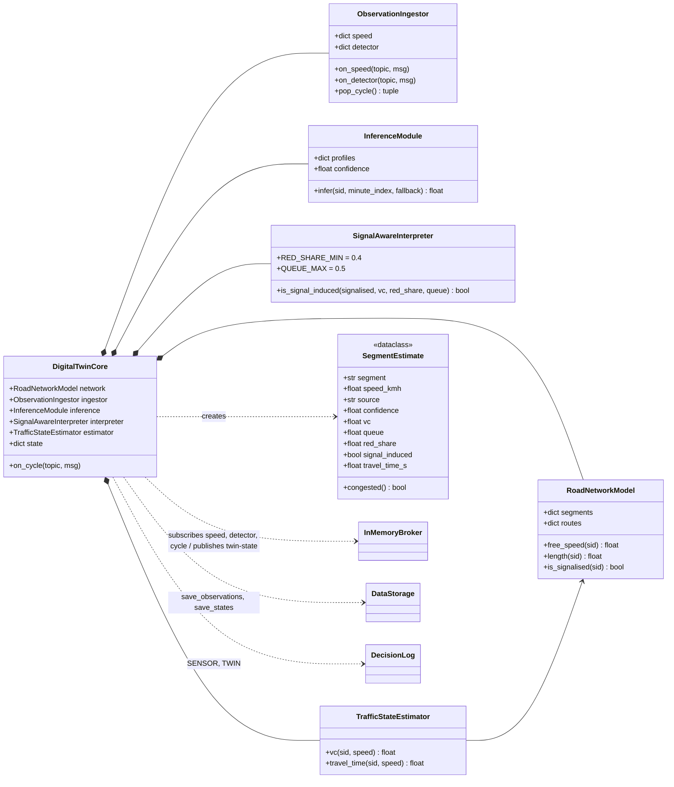
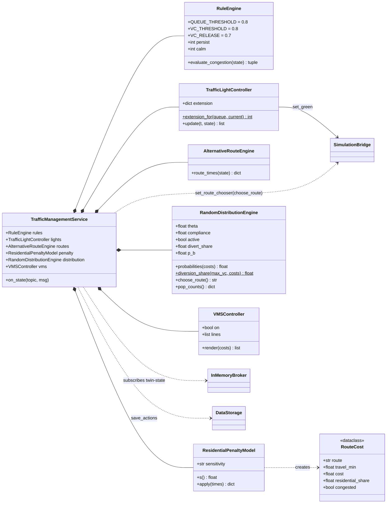
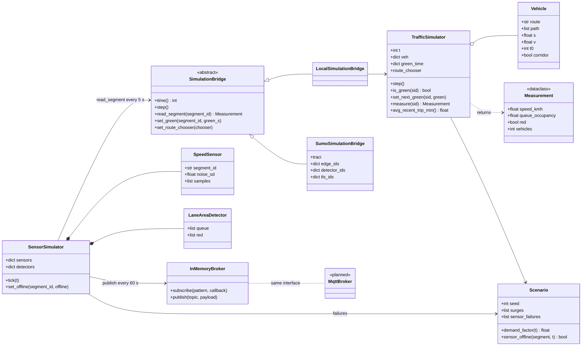
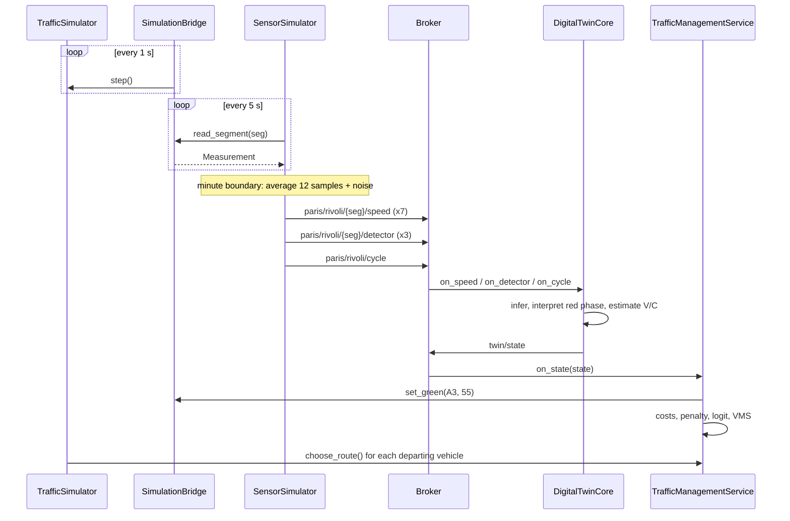
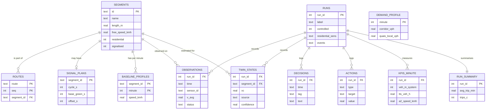

# C4 Level 4 - Code

Derived from the Python reference implementation in `rivoli_twin/`. One module per container, one class per component.

| C4 container | Python module | Main classes |
|---|---|---|
| Scenario generator | `scenario_generator.py` | `Scenario`, `Surge`, `SensorFailure`, `build_baseline_profiles()` |
| SUMO (stand-in) | `traffic_simulator.py` | `TrafficSimulator`, `Vehicle`, `Measurement` |
| Simulation bridge | `simulation_bridge.py` | `SimulationBridge`, `LocalSimulationBridge`, `SumoSimulationBridge` |
| Sensor simulator | `sensors.py` | `SensorSimulator`, `SpeedSensor`, `LaneAreaDetector` |
| Message broker | `broker.py` | `InMemoryBroker` (an `MqttBroker` adapter with the same interface is planned, not implemented) |
| Digital twin core | `twin_core.py` | `DigitalTwinCore` + 5 components |
| Traffic management | `traffic_management.py` | `TrafficManagementService` + 6 components |
| Data storage | `storage.py` | `DataStorage` (SQLite schema) |
| Wiring / KPIs | `system.py` | `run()`, `KPIEvaluator` |

## Digital twin core

## Traffic management service

## Sensing, broker, bridge and simulator

## Code-level sequence: one minute

## Data storage schema

